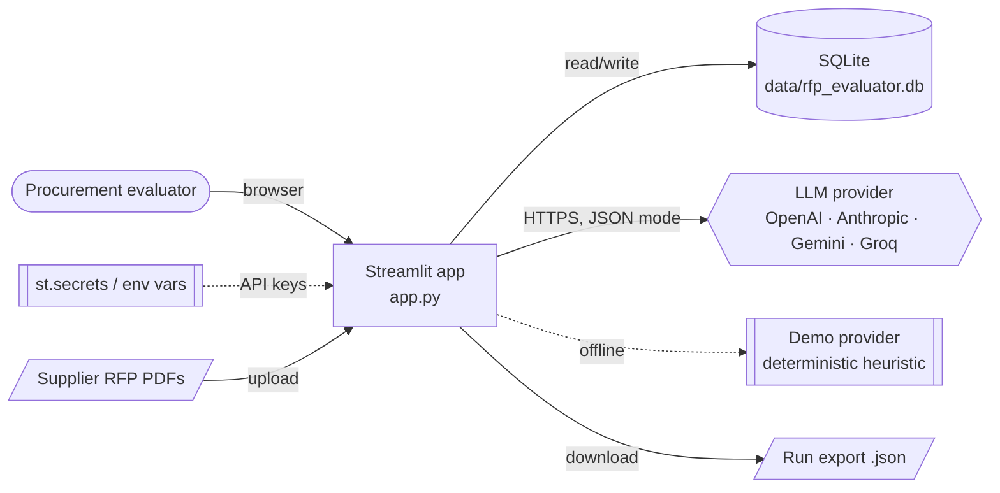
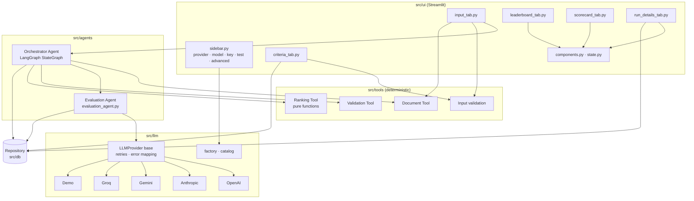
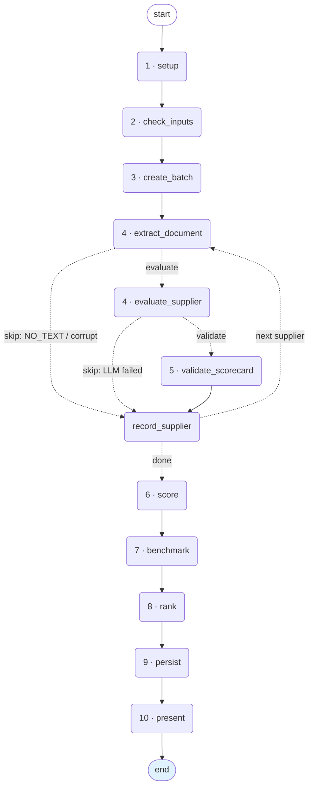
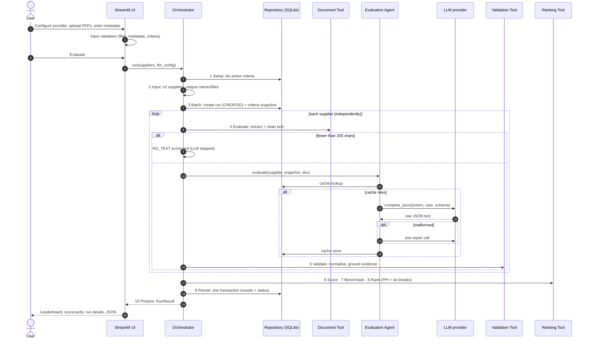
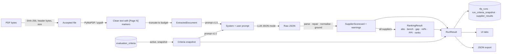
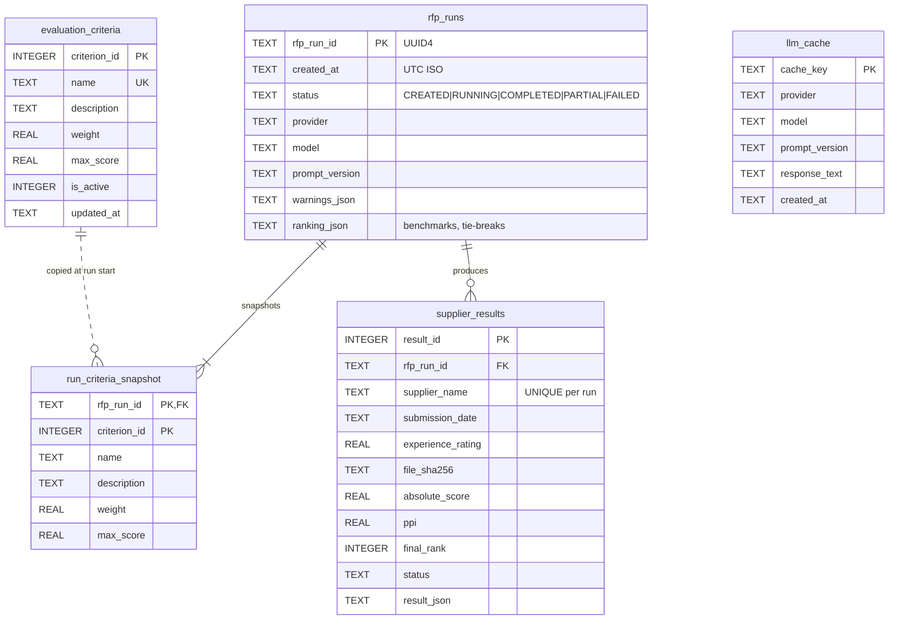

# Architecture

## 1. System context

## 2. Components

## 3. Orchestrator graph (LangGraph)

The Orchestrator Agent is a LangGraph `StateGraph` (`src/agents/orchestrator.py`), compiled as
`rfp_evaluation`. Each node is one step of the brief. Conditional edges handle the per-supplier loop
and the two short-circuits: a corrupt or image-only PDF skips the LLM, and a failed LLM call skips
validation. This diagram is generated by `Orchestrator(...).mermaid()`:

**State vs. resources.** The graph state (`RunState`, a `TypedDict`) holds only data: suppliers,
snapshot, the current index, the document, scorecards and the ranking. Live resources (the repository,
the LLM provider and the Evaluation Agent) belong to the `Orchestrator` instance and are used by the
nodes, so the state stays serialisable and the graph is a pure description of the workflow.

**Control flow.** Expected failures raise from inside a node and propagate out of `graph.invoke`:
`ValidationError` (nothing is created), `RunAbortedError` (invalid key; the run is marked FAILED) and
`PersistenceError` (rolled back; the run is marked FAILED). The recursion limit is set to
`25 + 5 × suppliers`, since each supplier visits at most four nodes.

## 4. The 10-step pipeline (sequence)

## 5. Data flow

## 6. Entity-relationship diagram

`run_criteria_snapshot` deliberately copies values instead of referencing `evaluation_criteria`, so
editing or deleting a criterion never changes a past run.

## 7. Agent and tool responsibilities

| Component | Responsibility | Uses LLM? | Does arithmetic? | I/O |
|---|---|:-:|:-:|---|
| Orchestrator Agent (LangGraph `StateGraph`) | One node per step 1–10, conditional edges for the supplier loop and skips; emits progress, decides run status, stops on an invalid key | No | No (only counts) | Through tools/repository |
| Evaluation Agent | Builds the prompt from criteria, fences the document, calls the LLM, cache, one repair | **Yes** | No | LLM, cache |
| Document Tool | Extraction (PyMuPDF → pypdf), cleaning, page markers, NO_TEXT detection, truncation | No | No | Reads bytes |
| Validation Tool | Parse JSON; rules V01–V09; evidence grounding; warnings | No | Coercion and clipping only | None |
| Ranking Tool | Absolute score, benchmark, gap, relative %, PPI, tie-break, ranks, explanations | No | **Yes, all of it** | None (pure) |
| Input validation | Criteria, file and metadata checks for the UI | No | Weight total | None |
| Repository | All SQL (parameterised), transactions, cache | No | No | SQLite |
| LLM adapters | Native JSON or structured output per SDK; retries; error mapping; key redaction | Yes | No | HTTPS |

## 8. Design decisions and trade-offs

| Decision | Why | Trade-off |
|---|---|---|
| LangGraph `StateGraph` for orchestration, with deterministic edges | Makes the agentic workflow explicit and visual (one node per step, a diagram generated from code), and branches and loops are declared rather than hidden in `if`s | Adds a dependency; routing is rule-based, not LLM-decided, by design (the brief fixes the step order) |
| No LangChain LLM wrappers; providers are called through their own SDKs | Each SDK's native structured-output mode, and precise error mapping and key redaction | The four small adapters are maintained in this repo |
| One LLM call per supplier, no cross-supplier context | Independent judgement; prevents anchoring; failures stay isolated | More calls than a single batch prompt |
| LLM returns raw criterion scores only | Arithmetic and ranking must be deterministic and auditable | The model cannot "weigh" criteria itself |
| Cache raw LLM text, validate on every read | Byte-identical re-runs; validation improvements still apply to cached results | Prompt changes require a `PROMPT_VERSION` bump |
| Retries in the base class, SDK retries off | One consistent policy and one place to test it | Ignores provider-specific `retry-after` hints |
| Snapshot criteria per run | Editing criteria mid-run or later cannot change results | Small amount of duplicated data |
| Failed suppliers stay in the ranking with zeros | The leaderboard shows the whole batch; status badges explain why | A failed supplier appears last rather than hidden |
| Fuzzy evidence check flags but never changes scores | Scoring stays with the model; humans see the doubt | An unverified quote can still carry a high score |
| Demo provider in the product | Classroom demo and CI without keys or cost | Must be clearly labelled as not AI (it is, everywhere) |
| Each repository call opens its own connection | Safe across Streamlit's per-session threads | Slightly more overhead than pooling |

## 9. Security considerations

**API keys**
- The key is held only in `st.session_state` (the password widget). It is never written to SQLite,
  the cache, logs, exports or messages. `LLMConfig.api_key` is excluded from `repr`.
- Every key is registered with `src/utils/secrets.py`. A logging filter redacts registered keys from
  messages and exception text, and error messages are rebuilt from fixed templates, never from SDK text.
  `tests/test_llm_providers.py` checks this with an SDK error that echoes the key.
- The UI shows only the masked form (`sk-…abcd`) and the source (sidebar, `st.secrets` or environment).

**Prompt injection**
- The document is wrapped in `<supplier_document>` tags and the system prompt declares it untrusted;
  any copy of the fence tags inside the document is neutralised (`sanitize_document`).
- The model cannot affect the outcome beyond its per-criterion scores: they are clipped to the database
  `max_score`, ranks come from Python, and claims without matching evidence are flagged.
- `sample_data/edge_cases/prompt_injection.pdf` and the orchestrator tests confirm the injected supplier
  is ranked last and the attempt is reported as a risk.

**SQL injection**
- All SQL lives in `src/db/repository.py` and uses `?` placeholders; no value is ever formatted into SQL.
  CHECK and UNIQUE constraints are a second line of defence.

**Uploads**
- Files are checked by header bytes (not extension), size (10 MB), SHA-256 duplicates, encryption and
  parse errors before any LLM call. PDFs are only parsed, never rendered or executed.

**Error handling**
- `client.showErrorDetails = "none"` plus a per-tab error boundary: users see friendly messages; full
  tracebacks go to the (redacted) log.
